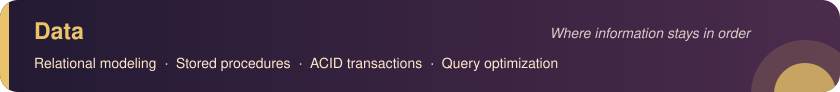

  

  

<a href="#-a-bit-about-me">About me</a> &nbsp;•&nbsp; <a href="#-projects">Projects</a> &nbsp;•&nbsp; <a href="#-my-toolbox">Toolbox</a> &nbsp;•&nbsp; <a href="#-lets-connect">Contact</a>

## 👋 A bit about me

I'm glad you stopped by. Grab a coffee ☕ and look around.

I'm a Full Stack developer and Systems Engineering student. I enjoy turning complex requirements into clear, well-structured software: clean REST APIs on the backend and friendly React interfaces on the frontend.

<table>
  <tr>
    <td width="33%" valign="top"><b>🧱 How I build</b> Clean Architecture, SOLID and code that is easy to test and maintain.</td>
    <td width="33%" valign="top"><b>🌱 What I'm learning</b> Microsoft Azure: App Service, Azure SQL and DevOps pipelines. Also testing and CI/CD.</td>
    <td width="33%" valign="top"><b>📚 Where I study</b> Systems Engineering at Unisalamanca and the Backend Development specialization at Riwi.</td>
  </tr>
</table>

## 🚀 Projects

<table>
  <tr>
    <td width="50%" valign="top">
      <h3>📋 Proyectandtask</h3>
      
Project and task management API. Each user sees only their own work and can track progress per project. Includes unit and integration tests, plus a GitHub Actions pipeline to Azure.

      
    

      
<a href="https://github.com/ChrisOnfroy/ProyectoAndTarea.Backend"><b>View code →</b></a>

    </td>
    <td width="50%" valign="top">
      <h3>🎓 SkillHub</h3>
      
Enrollment platform for in-person workshops: capacity limits, schedule overlap checks, bulk Excel enrollment and PDF certificates.

      
    

      
<a href="https://github.com/ChrisOnfroy/skillhub.Backend"><b>Backend →</b></a> &nbsp;·&nbsp; <a href="https://github.com/ChrisOnfroy/skillhub.Frontend"><b>Frontend →</b></a>

    </td>
  </tr>
  <tr>
    <td width="50%" valign="top">
      <h3>⚽ Canchero</h3>
      
API to find sports fields, manage venues and handle bookings, with role-based access and location search through OpenStreetMap.

      
   

      
<a href="https://github.com/ChrisOnfroy/Canchero.Backend"><b>View code →</b></a>

    </td>
    <td width="50%" valign="top">
      <h3>🏗️ Firmeza</h3>
      
Sales and inventory API with a customer storefront: product catalog, shopping cart, stock control and email receipts.

      
   

      
<a href="https://github.com/ChrisOnfroy/FirmezaProyecto.Backend"><b>Backend →</b></a> &nbsp;·&nbsp; <a href="https://github.com/ChrisOnfroy/FirmezaProyecto.Frontend"><b>Frontend →</b></a>

    </td>
  </tr>
  <tr>
    <td width="50%" valign="top">
      <h3>☁️ TaskApi</h3>
      
Task API with a rich domain model, designed for Azure App Service and Azure SQL using Managed Identity, so the database needs no stored password in Azure.

      
   

      
<a href="https://github.com/ChrisOnfroy/TaskApi.Backend"><b>View code →</b></a>

    </td>
    <td width="50%" valign="top">
      <h3>😊 Emotians</h3>
      
Real-time facial expression recognition from a webcam, with models trained from scratch and a web API. Built with Juan Benavides.

      
   

      
<a href="https://github.com/ChrisOnfroy/Emotians"><b>View code →</b></a>

    </td>
  </tr>
</table>

<b>📂 More projects and practice work</b>

 

| Project | What it is | Stack |
|---|---|---|
| [MyApp API](https://github.com/ChrisOnfroy/myC-API) | Customers, products and categories with Clean Architecture and tactical DDD | C#, .NET, EF Core |
| [Java microservices](https://github.com/ChrisOnfroy/microservices_java_project) | Separate services for clients and tasks | Java, Spring Boot, JPA, MySQL |
| [CajeroC](https://github.com/ChrisOnfroy/La-Cooperativa-Financiera-El-Progreso) | Console app for cooperative members, savings and reports | C#, .NET, LINQ |
| [Gym project](https://github.com/ChrisOnfroy/gymjavaproject) | User and role management practice project | Java, Spring Boot, MySQL |

<a href="https://github.com/ChrisOnfroy/?tab=repositories">See all my repositories →</a>

## 🧰 My toolbox

  
   
  

 

  
   
  

 

  
   
  

 

  
   
  

 

  
   
  

 

## 📈 GitHub activity

  
  

## 🍿 Beyond code

I'm a big Marvel Cinematic Universe fan. My favorites: *Avengers: Endgame*, *Spider-Man: No Way Home* and *Captain America: The Winter Soldier*. Tell me yours!

## 🤝 Let's connect

Have a project, an opportunity or just want to talk about code (or Marvel)? My inbox is open.

  

Thanks for visiting. Come back soon! 🧡

