

  

  

<a href="#-a-bit-about-me">About me</a> &nbsp;•&nbsp; <a href="#-projects">Projects</a> &nbsp;•&nbsp; <a href="#-my-toolbox">Toolbox</a> &nbsp;•&nbsp; <a href="#-lets-connect">Contact</a>

## 👋 A bit about me

I'm glad you stopped by. Grab a coffee ☕ and look around.

  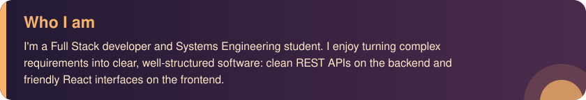

 

  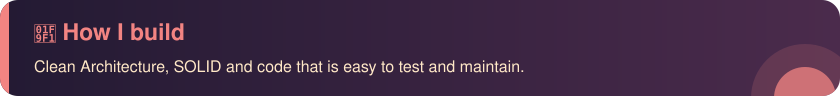

 

  

 

  

 

## 🚀 Projects

  <a href="https://github.com/ChrisOnfroy/ProyectoAndTarea.Backend">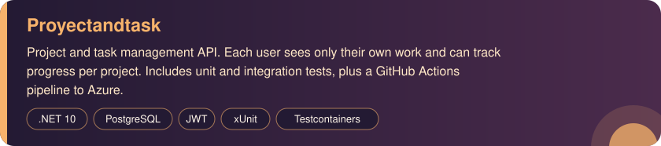</a>
   
  <a href="https://github.com/ChrisOnfroy/ProyectoAndTarea.Backend"><b>View code →</b></a>

 

  
   
  <a href="https://github.com/ChrisOnfroy/skillhub.Backend"><b>Backend →</b></a> &nbsp;·&nbsp; <a href="https://github.com/ChrisOnfroy/skillhub.Frontend"><b>Frontend →</b></a>

 

  <a href="https://github.com/ChrisOnfroy/Canchero.Backend">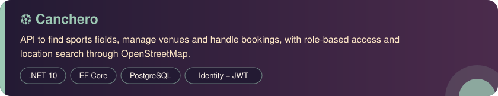</a>
   
  <a href="https://github.com/ChrisOnfroy/Canchero.Backend"><b>View code →</b></a>

 

  <a href="https://github.com/ChrisOnfroy/FirmezaProyecto.Backend">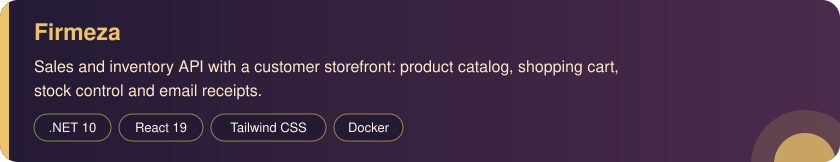</a>
   
  <a href="https://github.com/ChrisOnfroy/FirmezaProyecto.Backend"><b>Backend →</b></a> &nbsp;·&nbsp; <a href="https://github.com/ChrisOnfroy/FirmezaProyecto.Frontend"><b>Frontend →</b></a>

 

  <a href="https://github.com/ChrisOnfroy/TaskApi.Backend">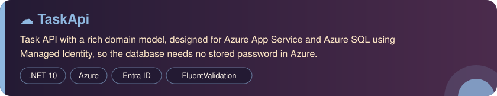</a>
   
  <a href="https://github.com/ChrisOnfroy/TaskApi.Backend"><b>View code →</b></a>

 

  <a href="https://github.com/ChrisOnfroy/Emotians">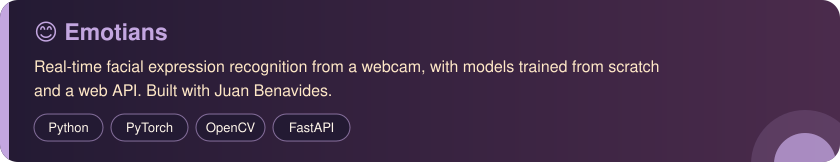</a>
   
  <a href="https://github.com/ChrisOnfroy/Emotians"><b>View code →</b></a>

 

<b>📂 More projects and practice work</b>

 

  <a href="https://github.com/ChrisOnfroy/myC-API">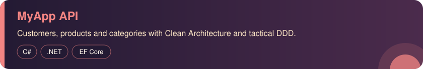</a>
   
  <a href="https://github.com/ChrisOnfroy/myC-API"><b>View code →</b></a>

 

  <a href="https://github.com/ChrisOnfroy/La-Cooperativa-Financiera-El-Progreso">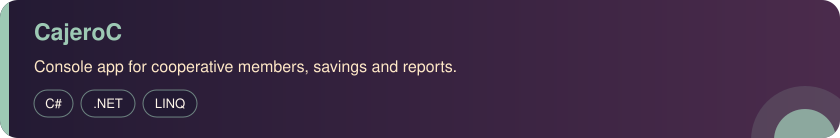</a>
   
  <a href="https://github.com/ChrisOnfroy/La-Cooperativa-Financiera-El-Progreso"><b>View code →</b></a>

 

  <a href="https://github.com/ChrisOnfroy/?tab=repositories">See all my repositories →</a>

## 🧰 My toolbox

  
   
  

 

  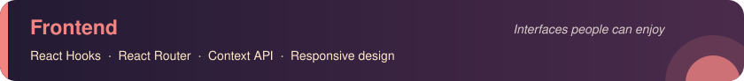
   
  

 

  
   
  

 

  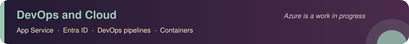
   
  

 

  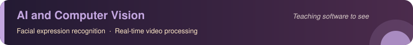
   
  

 

## 📈 GitHub activity

  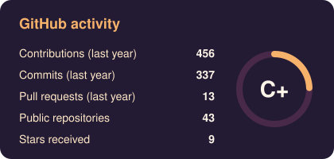
  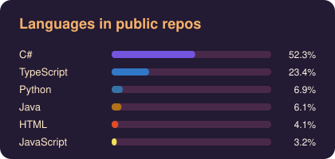

## 🍿 Beyond code

I'm a big Marvel Cinematic Universe fan. My favorites: *Avengers: Endgame*, *Spider-Man: No Way Home* and *Captain America: The Winter Soldier*. Tell me yours!

## 🤝 Let's connect

Have a project, an opportunity or just want to talk about code (or Marvel)? My inbox is open.

  

Thanks for visiting. Come back soon! 🧡

